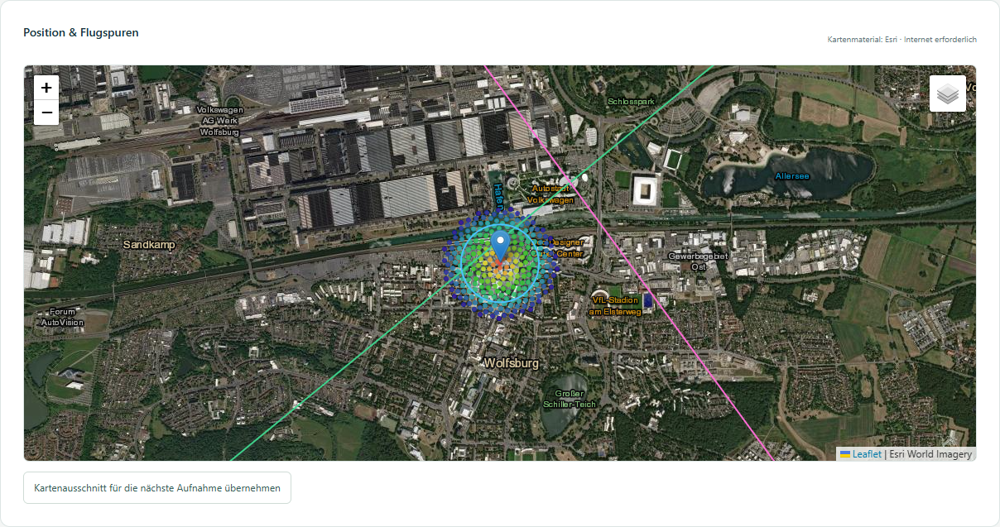
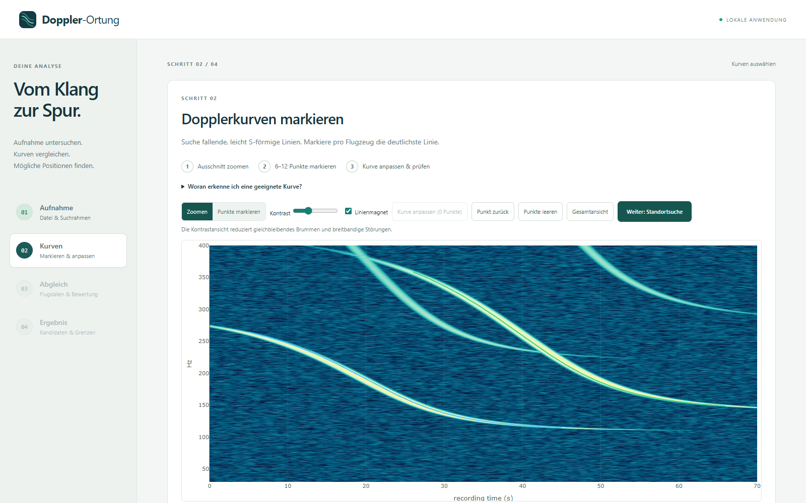

# Aufnahmeort-Erkennung

Die Aufnahmeort-Erkennung untersucht, wo eine Audio- oder Videoaufnahme entstanden sein könnte – anhand der darin hörbaren Flugzeuggeräusche. Beim Vorbeiflug wechselt der Ton eines Flugzeugs von höher zu tiefer.

In einem Spektrogramm, also einer grafischen Darstellung der Aufnahme, wird dieser Verlauf als Dopplerkurve sichtbar. Du markierst diese Kurven und gibst Aufnahmedatum sowie Suchregion an.

Die Software lädt historische Flugdaten und berechnet für mögliche Orte, welcher Tonverlauf zu den damaligen Flugbewegungen passen würde. Die besten Übereinstimmungen erscheinen mit den Flugspuren auf einer Karte und grenzen den möglichen Aufnahmeort ein.

## Installation und Start

**[Windows-Paket herunterladen](https://github.com/LeNevio1337/Aufnahmeort-Erkennung/releases/latest/download/Aufnahmeort-Erkennung-Windows.zip)**

1. Die ZIP-Datei vollständig entpacken. Eine zusätzliche Installation ist nicht nötig.
2. `Start.cmd` doppelklicken. Die Oberfläche öffnet sich im Browser.
3. Das Startfenster während der Nutzung geöffnet lassen.

Die Audioanalyse läuft auf deinem Rechner. Für historische Flugdaten und Karten wird eine Internetverbindung benötigt.

## Eine Aufnahme untersuchen

1. Audio- oder Videodatei auswählen, das Aufnahmedatum in UTC angeben und die Suchregion festlegen.
2. Im Spektrogramm den Verlauf einer Flugzeugpassage mit Punkten markieren und die Kurve anpassen. Weitere Passagen lassen sich ebenfalls markieren.
3. Den Abgleich starten und anschließend die möglichen Aufnahmeorte auf der Karte ansehen.

Zum Beenden im Startfenster `Strg+C` drücken.
